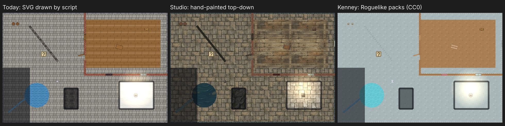

# The Loom — Game Art Spike — Report

**Status:** Done (2026-11-06). The spike scoped in [`art-spike.md`](./art-spike.md). Direction chosen by the user at checkpoint 2: **studio-led** (§6).
**Spent:** $2.24 of the $30 cap, for 32 charged images. 3 more failed while the model was busy, and failures aren't charged.
**Branch:** `spike/game-art` keeps the trial art and its renders. Merged: this report, `scripts/art/`, and the PNG switch in `materials.js` and the painter (§5).

---

## 1. The answer

The image studio can make a coherent, game-ready asset library for the painter that L-920 built:

- floors, wall and door surfaces, and props;
- in one hand-painted top-down style;
- at about **$0.08 per finished asset**;
- drawn by the real engine within its time budget.

It takes a pipeline and a few rules about what to generate and how (§3). Kenney's free packs are consistent and safe to use (CC0), but they're built for tile-grid games in a three-quarter view, which doesn't fit maps drawn from free geometry (§4).

_The painter's test dungeon: today's SVG, the studio's art, and Kenney's Roguelike tiles, each drawn by the engine. The trial art itself stays on `spike/game-art`._

---

## 2. What was made

28 assets, each named like the SVG it replaces:

| Kind     | Assets                                                                                                        |
| -------- | ------------------------------------------------------------------------------------------------------------- |
| Floors   | flagstone, stone, marble, rock, dirt, wood, water                                                             |
| Walls    | stone, brick, rock (wall-top textures, drawn as strips by the painter)                                        |
| Doors    | wood, iron (surface textures, drawn as strips)                                                                |
| Lines    | stream                                                                                                        |
| Windows  | glass                                                                                                         |
| Props    | crate, brazier, statue, pillar, chest, barrel, bed, sarcophagus, cauldron, rug, table, chair, wardrobe, bench |
| Not made | bookshelf, altar, anvil: each kept showing its front (§3.2)                                                   |

---

## 3. Findings

### 3.1 Methods (checkpoint 1 and the comparison)

| Method                               | Truly top-down      | Matches the approved look          | Cost per prop |
| ------------------------------------ | ------------------- | ---------------------------------- | ------------- |
| A: style written in the prompt       | 2 of 3              | Drifts (lighter, more orange wood) | $0.07         |
| C: saved style with reference images | 2 of 3              | Closest                            | $0.07         |
| B: a 3 × 3 sheet, cut apart          | 14 of 24 (3 sheets) | Most consistent across a sheet     | about $0.01   |

- **Sheets in the saved style (B + C) are the way to make props.** Failures are retried as a sheet with the good props as references: that fixed 4 of 6.
- **The style** ("Loom painted top-down", `sty_43d0ddea6dd39781`) holds three references: the flagstone, the barrel and the top-down chest. A busy reference (the room vignette) was left out because its walls lean into three-quarter view.

### 3.2 What the model does well, and badly

- **Good first time:** floors, flat and round things (rugs, lids, cauldrons, slabs, statues seen from above), surface textures.
- **About half fail:** furniture with legs or a front (tables, chairs, wardrobes, altars, anvils, bookshelves). It shows the legs or front. Retries with references fix most. Tall furniture may have to keep a sliver of front, as painted tabletop maps often do.
- **Never right:** a wall's top as a strip, and doors seen from above. The model draws a wall's face or a ledge. **Fix:** generate square surface textures (stone, brick, planks, iron) and let the painter draw the strip, which it already does.
- **References copy layout, not only style.** A "variant" of the flagstone, and a marble floor with the flagstone as reference, both came back with its exact stone pattern. Variants must be made without a reference, or by editing the original.
- **Prompts are taken literally.** "Footprints worn smooth" gave footprints a tile across.

### 3.3 The pipeline (`scripts/art/`)

| Step       | Result                                                                                                                                                                                             |
| ---------- | -------------------------------------------------------------------------------------------------------------------------------------------------------------------------------------------------- |
| `slice`    | Found every cell of all four sheets by their key-colour gaps, and by dark divider lines one sheet drew though asked not to                                                                         |
| `key`      | Magenta removed with a soft edge and its spill taken out: at most 0.12% of any prop's pixels still key-coloured                                                                                    |
| `seamless` | Seam score (1 is perfect; an unrelated edge scores about 40) from about 2.4 raw to 0.7–1.4 for six floors. **Wood stayed at 3.5** with faint ghosting: strongly lined textures need another method |
| `fit`      | Sizes from the art's scale; ground pictures span 5 squares (§3.4)                                                                                                                                  |
| `check`    | The numbers above, per asset                                                                                                                                                                       |

### 3.4 In the engine

- **The painter now scales by each picture's own size** (merged), so sharper art draws at the size of the SVG it replaces. With today's SVGs the drawing is unchanged: the screenshot test matches.
- **A ground picture must span about 5 squares (25 ft).** At 1 square its stones were under a foot across. `PNG_ART` records each picture's span.
- **Speed:** the large test dungeon (36 rooms, 144 objects, 72 doors) draws in 1.36 s on a CPU slowed four times, against 0.96 s with SVG. Both are inside the 2 s budget.
- **File size is the main cost.** The seven floors are 3.4 MB each as 1280 px PNG, 22 MB in all. They need WebP or compressed PNG, and smaller pictures where detail allows, before shipping.
- **Props look pasted on** without a contact shadow. The painter should draw one under each object, so the art doesn't need to.

### 3.5 Running it

- **The model's quota sets the pace, not the studio.** Fourteen jobs at once lost three after five busy retries (L-396's limit). About four at a time finishes without failures.
- **Claude can run the whole loop from a session:** it makes images over MCP, looks at each, fetches them, and processes and renders them headless.
- **Your review** was two short checkpoints, about 15 minutes in all.

---

## 4. Kenney's packs (SP3)

- **Licence:** every pack checked says CC0: "free to use in personal, educational and commercial projects; crediting Kenney is not mandatory". Checked: Roguelike Dungeon, Roguelike Interior, Scribble Dungeons, Topdown Shooter.
- **Tried:** 21 tiles from the Roguelike Dungeon and Interior sheets, mapped to our floors, walls, doors and props, enlarged 4× with nearest-pixel scaling.
- **Result:** consistent and well made, but a poor fit for this engine:
  - its 16 px tiles become near-flat colour at a square each;
  - its walls are whole tiles in three-quarter view, and squeezed into our thin wall strips they become a dotted line;
  - its props are drawn front-on against our top-down.
- Kenney fits a tile-grid engine; L-920 draws free geometry. Its UI and icon packs may still be useful elsewhere (the user has the UI and Icons sets in the same folder).
- **Getting the files:** the Drive connector passes files through the conversation, which corrupted an image when it was copied out. A folder shared by link downloads straight to disk.

---

## 5. What's merged

- **`scripts/art/`:** `fetch`, `slice`, `key`, `seamless`, `fit`, `check` (`node scripts/art/art.js <step> …`).
- **`materials.js`** (both copies): `PNG_ART`, art made as pictures, with a ground picture's span. It's empty, so every material and object stays SVG. Each material carries its `span`.
- **`paint.js`:** strips and ground scaled by the picture's own size and span.

---

## 6. Recommendation and the epic's open questions

**Direction (the user, checkpoint 2): studio-led, building on the approved look.** SVG stays as the fallback.

**A projection.** A full setting is about 150–300 assets: at $0.08 each, about $12–25 of generation, plus review. All four reference games, sharing some assets, would be about $50–80 over time. The cost that matters is review time and Claude's time, not money.

**Questions for the art epic's gap sheet:**

1. **Format and size:** WebP or compressed PNG? What largest size for ground pictures?
2. **Atlases:** pack props into sprite sheets now, or once there are hundreds?
3. **Variants:** how many per floor, and does the painter choose among them per area?
4. **Blending where floors meet:** soft masks between materials, now or later?
5. **Contact shadows** under objects, drawn by the painter: in this epic?
6. **Tall furniture:** accept a sliver of front (bookshelves, wardrobes, altars, anvils), or keep retrying for true top-down?
7. **Lined textures (wood):** generate them seamless another way (as strips, or by edit), or accept faint seams?
8. **Order of settings:** sword and sorcery first (the dungeon set), then steampunk, wizarding and space?
9. **Review:** you approve each batch on a board, or only samples?
10. **Culling** off-screen items: needed once maps are large. With this epic or after?
