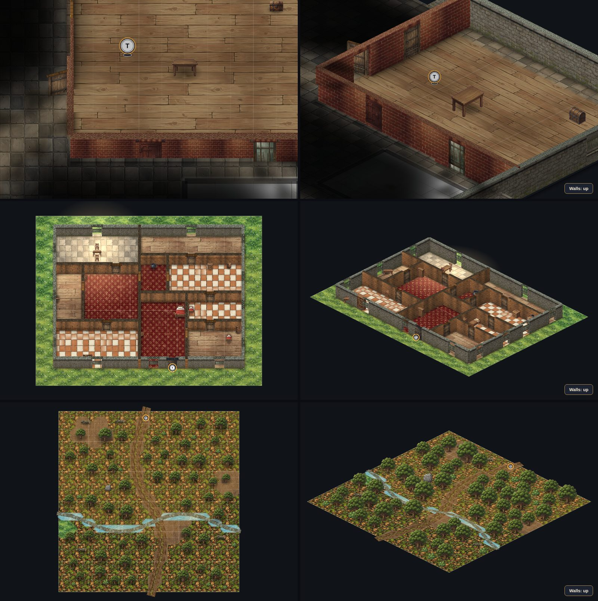
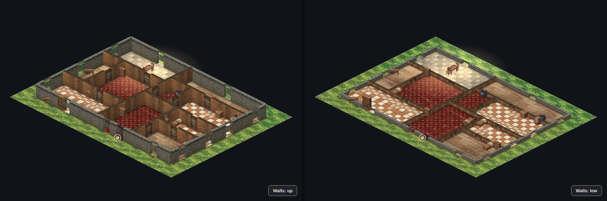
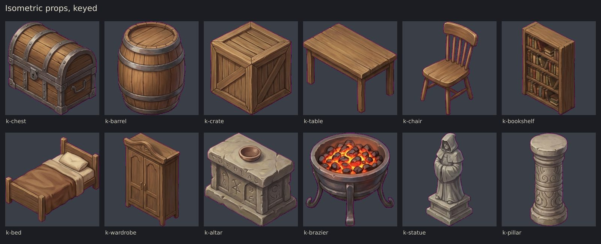
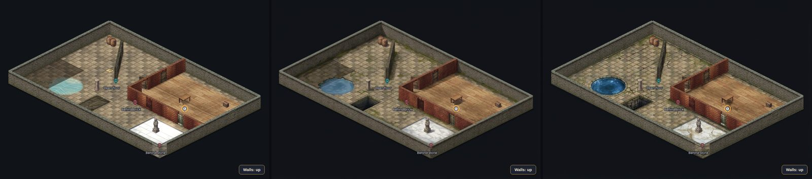

# The Loom — The Isometric Spike — Report

**Status:** Built and measured (2026-11-15). Waiting on the user's checkpoint (§6): playing the preview.
**Scope:** [`isometric-view.md`](./isometric-view.md) §5.
**Spent:** $0.70 of the $10 cap, for 5 images: three prop sheets and two paintings.
**Branch:** `spike/isometric` (draft PR #855, not to merge) holds the prototype, the props and the paintings. Its preview channel serves the page with them.

---

## 1. The answer

**The isometric view fixes what the three-quarter view got wrong:**

- walls in both directions stand with a face;
- doors and windows stand upright in both;
- a click on a door's drawn panel opens that door, whichever way its wall runs.

It needs no change on the server or in any world's data. The studio paints isometric props well, and reused floors, wall faces, doors and windows look right laid onto the new planes.

The one thing screenshots can't settle is how it feels in play. That's the checkpoint (§6).

_Three-quarter on the left, isometric on the right, each drawn by the engine from the same data. Top: the test dungeon close up; in three-quarter, the brick room's west wall is a thin line and its door barely shows. Middle: a generated interior. Bottom: a generated forest track._

---

## 2. What was built (spike branch only)

- **The grid view's isometric mode,** switched on by `?view=iso`:
  - the floor layers (ground, lines, shadows, fog, the path) are drawn under a 2:1 isometric transform;
  - **the painter builds the standing layer isometric:**
    - walls as prisms, each with its face toward the camera, its end and its cap, shaded by direction;
    - doors and windows in both directions, an open door swung;
    - props standing on their footprint's front corner, chosen by facing;
    - everything sorted by its foot's depth;
  - tokens, labels, fight cards, fading and the mask over squares not seen are projected to match;
  - clicks are worked back to the floor, or to the front-most door or object drawn under the pointer;
  - hovering lights what a click will pick;
  - **a "Walls: up/low" button** drops every wall to a 2 ft stub.
- **The code:** about 300 lines added to `paint.js`, 250 to `battle.js` and 3 to `draw.js`. The three-quarter view is untouched without the flag.
- **12 isometric props** from the studio: front and back, mirrored to four facings, 248 KB as WebP.
- **One painting trial:** the test dungeon painted from an isometric guide of its geometry, drawn two ways (§4.4).

---

## 3. What it answers

| Question (§5.1)                  | Answer                                                                                                                                                                                                  |
| -------------------------------- | ------------------------------------------------------------------------------------------------------------------------------------------------------------------------------------------------------- |
| 1. Does it fix the feel?         | **In screenshots and scripted clicks, yes.** Every door in the test dungeon (shut, ajar, locked, glazed) was picked by a click on its drawn panel, in both wall directions. Play is the checkpoint (§6) |
| 2. Can the studio paint props?   | **Yes, better than three-quarter.** 12 of 12 fronts right first time; backs 4 of 6, the other 2 right on one retry (§4.2)                                                                               |
| 3. Do reused flat surfaces work? | **Yes.** Floors, wall faces, doors and windows from the `classic` set laid onto the planes look right; trees and rocks in their three-quarter art pass too                                              |
| 4. What does the painter cost?   | **15–50% more draw time** than three-quarter on the large fixture (§4.5)                                                                                                                                |
| 5. Isometric paintings?          | **The studio repaints a guide within a few pixels,** so both ways work. Floor-only keeps every interaction; whole is richer but breaks fading, walls-low and doors' states (§4.4)                       |

---

## 4. Findings

### 4.1 The view

- **Walls in both directions, doors in both.** This is the main gain (§1's picture, top row).
- **Walls near the camera hide more.** The south and east walls of every room face the camera and cover the room behind them. Fading helps around tokens and the pointer. **The walls-low button is what makes a room readable** (below), so it belongs in L-953 as decided (IS4).
- **The wall height:** the spike uses the true 2:1 height, a foot rising 1.22 floor units up the screen. Walls look solid but tall. `&rise=0.9` on the preview shows lower walls to compare (§6, C2).
- **Diagonal walls** (45° on the map) show as thin lines, as the design warned. The test dungeon's one diagonal wall shows it. The generators build square-on walls.
- **Natural props** (trees, bushes, rocks, logs) drawn in three-quarter art look right from the isometric angle, so they may not need repainting. **Furniture does.**

_A generated interior, walls up (left) and walls low (right)._

- **Depth order, found in play (2026-11-15):**
  - **What went wrong:** in The Corpse Tide's Market Hall, a desk in the next room showed through a wall near the wall's end. The spike sorted each prop by its footprint's front corner, one number against one number per wall piece, which put the desk in front.
  - **The spike's fix:** props sort by their middle, and walls are cut into half-tile pieces. That fixed the desk and kept a crate standing in front of a wall in front of it.
  - **For L-952:** a single depth per piece can still mis-order large props beside long walls. The real build should compare what overlaps on the screen by which side of a wall each thing stands, as isometric engines do.
- **Painted maps, found in play:**
  - **What went wrong:** the spike first kept a grid's own painting in place of its walls and floors, so The Border March's painted maps showed no walls, only flat door marks.
  - **The fix:** every grid now draws its walls, doors and floors from its data, with an old painting used only as the floor where the map has no floor of its own. That matches AR2.

### 4.2 The props

- **Method:** sheets of nine in the studio's final tier, no saved style, the first sheet as the reference for the rest. They were keyed and cut by `scripts/art/` (slice, key) as in the art spike, with no changes needed.
- **Fronts:** 12 of 12 right first time, all at the true 2:1 angle with their fronts toward the lower left.
- **Backs:** the chest, bookshelf, wardrobe and altar came out right. The chair and bed came back as fronts again: the model draws an object's usual view unless told plainly which part is nearest the viewer. One retry with that wording ("its backrest nearest the viewer", "its headboard nearest") fixed both. **The prompt rule for L-954:** describe a back by which part is nearest.
- **Long props** painted long one way (the table and the bed lie along the lower-left diagonal) are mirrored when their footprint runs the other way. The manifest records each picture's long axis.
- **Projection:** 45 objects and decor, a front each and a back where they aren't symmetric, is about 8–10 sheets. At $0.14 a sheet with retries that is **about $2–3**, well under the design's $10.

### 4.3 Reused art

The painter lays each flat picture onto its plane with an affine transform, which is exact for a flat surface:

- floors, with their soft edges and variants (L-943);
- wall faces, shaded lighter facing lower left and darker facing lower right;
- door leaves and window panes in either wall direction;
- wall tops as caps.

Nothing in the `classic` set's 65 materials needs painting again.

### 4.4 Isometric paintings

_Left: the art set only. Middle: a whole painting, its walls cut out over tokens behind them. Right: a painting of the floors only, with walls, doors and props standing from the data._

- **How:** the painter drew the map isometric with no fog or tokens as a layout guide. The studio repainted it ("keep every wall, door and object exactly in place"), and the painting was laid back over the same frame. **Both came back within a few pixels of the geometry.**
- **Whole, walls cut out:** the painting is the map. Each wall's outline is cut from the painting and drawn in the depth order, so a token behind a wall is covered by the painted wall (the token behind the south wall shows only its head). It is the richest look, but:
  - **fading and walls-low can't show what's behind a wall:** the painting has nothing painted there;
  - **doors and objects can't change:** an opened door, a chest opened, a lever pulled stay as painted, and a wall made low stays tall;
  - **a moved wall or prop needs the map painted again.**
- **Floor only:** the painting replaces the floor, and walls, doors and props stand from the data and the art set. Everything interactive keeps working, and the painting adds the floor's richness: grime, cracks, a pool with a rim. Its edges matched the walls.
- **Recommendation: floor only** (§6, C4). It gives most of the look with none of the losses. A whole painting could come back later for scenes that are only looked at.

### 4.5 Speed

| Large fixture (60 × 60 squares, 1,254 items), CPU slowed 4× | Draw time |
| ----------------------------------------------------------- | --------- |
| Three-quarter                                               | 3.2–3.5 s |
| Isometric (spike)                                           | 4.0–5.0 s |

- **Both are over the 2 s budget in this session's container,** which ran the same fixture far slower than the art spike's session did (0.96 s three-quarter then). The ratio is what counts: **isometric costs 15–50% more.**
- **Why:** 156 more pieces (walls cut into a prism's faces and caps), and **the spike switches culling off** in isometric, since culling still works in flat map units.
- **For L-952:** culling must work in isometric screen space; it does most of the saving on large maps.

### 4.6 Not covered by the spike

The real build (L-951–L-953) still needs:

- culling in isometric;
- town-to-grid zooms;
- the minimap;
- labels kept clear of walls;
- the dimmed fog over standing things;
- tests and screenshots;
- `Loom.battle.mapPoint` for tests.

---

## 5. What it changes in the plan

- **L-951 to L-953:** confirmed as designed. Add to L-952:
  - culling in isometric;
  - walls cut into prism pieces of at most a tile for the depth order;
  - the outline of each piece, for picking and lighting.
- **L-954, the props:** about 8–10 sheets, about $3. Two rules from §4.2:
  - backs are described by what's nearest the viewer;
  - each picture records its long axis.

  Natural props (trees, bushes, rocks, logs) may keep their three-quarter art: decide from L-954's first board.

- **L-955, art by view:** the isometric paintings, as the checkpoint decides (C4); floor-only is recommended.
- **The wall height** (rise): as the checkpoint decides (C2).

---

## 6. The checkpoint (yours)

**Play the preview.** Sign in on the preview's home page first (the Loom sends a signed-out visitor home, dropping the flag). Then open its Loom page as `/apps/loom/?view=iso` and play The Border March onto a battle map. The preview channel is linked from PR #855; it lasts an hour after its last deploy, so ask Claude to refresh it if it has expired.

- **Walk** a few rooms, open and close doors in both wall directions, open a chest, and walk behind a wall.
- **Fight once** (foes' cards are placed for isometric).
- **Try** the "Walls: up/low" button (bottom right) and hovering over doors.
- **Compare heights:** add `&rise=0.9` to the address to see lower walls.
- The world's own furniture shows the 12 isometric props where it uses those kinds; any other kind shows its three-quarter picture.

**Then answer:**

| ID     | Question                                                                         | Recommendation                                               |
| ------ | -------------------------------------------------------------------------------- | ------------------------------------------------------------ |
| **C1** | Go ahead with the isometric view (L-950)?                                        | **Yes**, if play confirms what the screenshots show          |
| **C2** | How tall walls look: true 2:1 (1.22, the default) or lower (`&rise=0.9`)?        | **Your eye in play.** True is the standard; lower hides less |
| **C3** | The props' look (§4.2): approve the style for the whole set?                     | **Yes**                                                      |
| **C4** | Isometric paintings of grid maps: whole with walls cut out, floor only, or none? | **Floor only** (§4.4)                                        |
| **C5** | Anything that felt wrong in play (clicks, doors, walls hiding things, speed)?    | —                                                            |

The stories L-951 to L-957 are then filed with what this report found, and the spike branch is closed.
